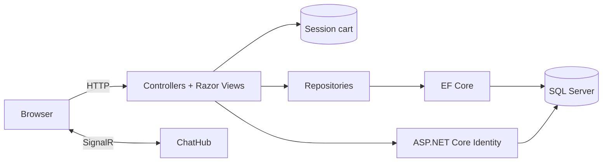
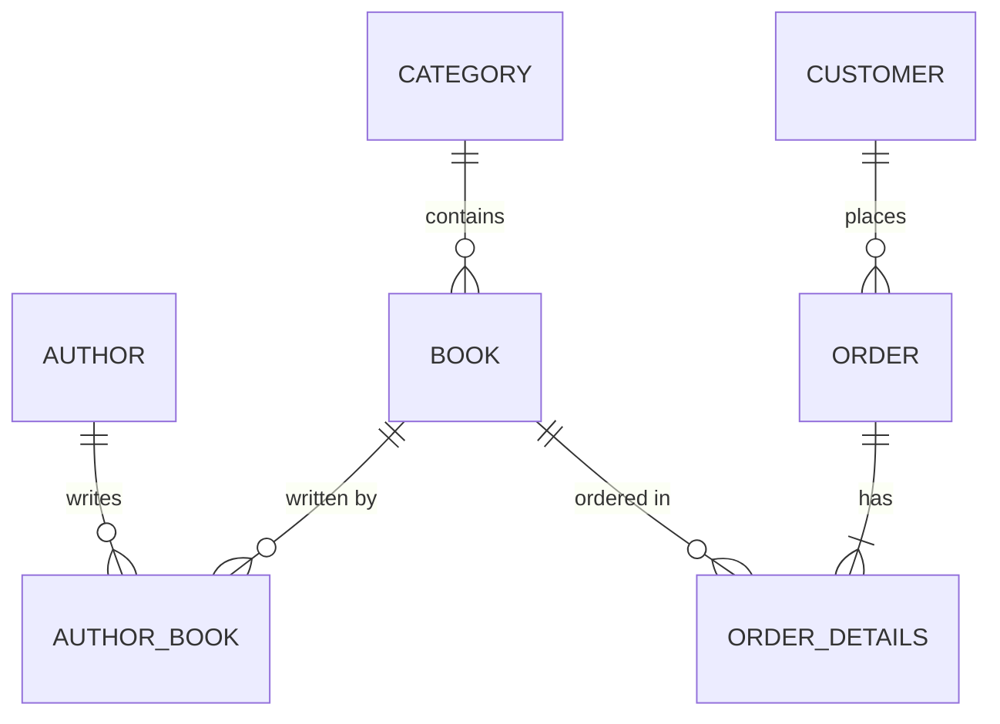

<h1 align="center">📚 BookStore</h1>

<p align="center">
  An online book store web application built with <b>ASP.NET Core 8 MVC</b>, <b>Entity Framework Core</b> and <b>SQL Server</b>.<br>
  Customers browse, search and order books; admins manage the catalog and track orders.
</p>

<p align="center">
  
  
  
  
  
  
</p>

---

## ✨ Features

**For customers**
- Browse all books and **search by name**
- Book details page with category, authors, price and available stock
- **Shopping cart** stored in the session (add, view, remove items) for logged-in users
- **Checkout** with customer name, phone and address (governorate, markaz, village)
- **Buy now** — order a single book directly without using the cart
- Order confirmation page
- Register / log in with ASP.NET Core Identity (new accounts get the `User` role)

**For admins** (`Admin` role)
- Manage **books**, **authors** and **categories** (create, edit, delete)
- A book can have **multiple authors** (many-to-many with publish date)
- View all orders and update the **order status**: Processing → Shipped → Delivered / Cancelled
- Register new admins and create roles

**Data integrity**
- Checkout runs inside a **database transaction**: customer, order and order details are saved together or not at all
- Stock is checked and decreased on checkout, with **optimistic concurrency** (`RowVersion`) so two customers can't buy the last copy at the same time
- **Custom validation attributes** for unique book id, unique customer phone and unique user phone
- Client-side and server-side validation with view models

**Real-time (experimental)**
- A **SignalR hub** (`/Chat`) with broadcast messages and chat groups

---

## 🏗️ Architecture



### Data model



---

## 📁 Project Structure

```
BookStore/
├── Controllers/
│   ├── ProductsController.cs      # Catalog, search, cart, checkout, buy now
│   ├── UserAccountController.cs   # Register / log in
│   ├── Admin*Controller.cs        # Partial AdminController: books, authors, categories, orders, roles
│   └── ChatController.cs
├── Models/                # Entities + BookStoreContext
├── ModelConfigurations/   # Fluent API configurations
├── ModelView/             # View models
├── Repository/            # Repository interfaces & implementations
├── Custom validation/     # Unique-value validation attributes
├── Migrations/            # EF Core migrations
├── Views/                 # Razor views (Products, Admin, UserAccount, Shared)
├── wwwroot/               # CSS, JS, book cover images
├── ChatHub.cs             # SignalR hub
├── SessionExtensions.cs   # Store objects in session as JSON
└── Program.cs
```

---

## 🧭 Main Pages

| Page | Route | Access |
| --- | --- | --- |
| Books list (home) | `/Products/ShowProduct` | Everyone |
| Search | `/Products/Search?Name=...` | Everyone |
| Book details | `/Products/BookDetails/{id}` | Everyone |
| Cart | `/Products/SeeCart` | Logged-in users |
| Checkout | `/Products/CheckOut` | Logged-in users (cart) |
| Buy now | `/Products/ProcessOfBilling?bookid=...&QuantityRequired=...` | Everyone |
| Register / Log in | `/UserAccount/Register`, `/UserAccount/LogIn` | Everyone |
| Manage books | `/Admin/BookAdmin`, `/Admin/GetBooks` | Admin |
| Manage authors | `/Admin/AuthorAdmin` | Admin |
| Manage categories | `/Admin/CategoryAdmin` | Admin |
| Manage orders | `/Admin/GetOrders` | Admin |
| Roles / new admin | `/Admin/AddROle`, `/Admin/Register` | Admin |

---

## 🚀 Getting Started

### Prerequisites
- [.NET 8 SDK](https://dotnet.microsoft.com/download/dotnet/8.0)
- SQL Server (LocalDB, Express or Docker)

### 1. Set the connection string

In `BookStore/appsettings.json`:

```json
{
  "ConnectionStrings": {
    "DB_Store": "Server=.;Database=BookStore;Trusted_Connection=True;TrustServerCertificate=True"
  }
}
```

### 2. Create the database and run

```bash
cd BookStore
dotnet restore
dotnet ef database update
dotnet run
```

### 3. Create the roles and the first admin

Registration assigns the `User` role, and admin pages require the `Admin` role.
Add both roles to the `AspNetRoles` table, register an account, then link it to `Admin` in `AspNetUserRoles`.
After that, new roles and admins can be created from the admin pages.

---

## ⚙️ CI

On every push to `main` / `master`, GitHub Actions restores and builds the project with .NET 8.

---

## 🛠️ Tech Stack

| Layer | Technology |
| --- | --- |
| Framework | ASP.NET Core 8 MVC, Razor Views |
| Data | Entity Framework Core, SQL Server |
| Auth | ASP.NET Core Identity (roles: `Admin`, `User`) |
| State | ASP.NET Core Session (cart) |
| Real-time | SignalR |
| UI | Bootstrap, jQuery validation |
| CI | GitHub Actions |

---

## 👤 Author

**Ahmed Rady** — .NET Backend Developer

[](https://www.linkedin.com/in/ahmedrady3002)
[](https://myprotofolio-94p.pages.dev/)
[](https://github.com/AhmedRady3002)
